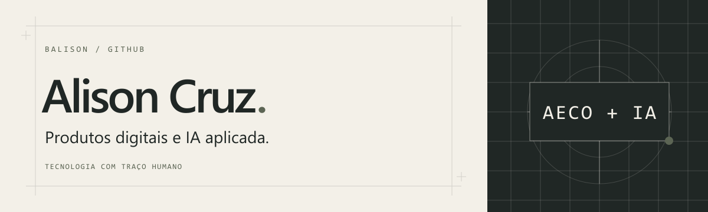
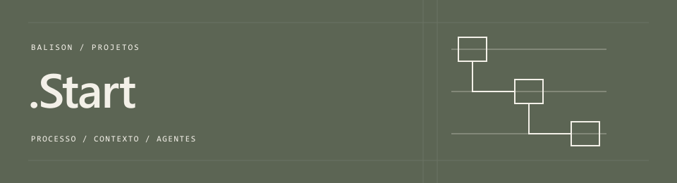

  <a href="https://www.linkedin.com/in/alison-s-cruz">LinkedIn</a> &nbsp; / &nbsp;
  <a href="https://www.instagram.com/iam.balison/">Instagram</a> &nbsp; / &nbsp;
  <a href="mailto:alison@balison.com.br">Contato profissional</a>

# Alison Cruz

Transformo processos e necessidades de negócio em produtos digitais. À frente da **Balison**, crio automações, sistemas, SaaS e plugins com IA aplicada, com experiência no setor **AECO (Arquitetura, Engenharia, Construção e Operação)**.

Atuo na identificação do problema, na organização do fluxo de trabalho e na construção da solução. Isso pode significar conectar ferramentas que não conversam entre si, transformar informações dispersas em um sistema ou criar uma função que falta em um software existente.

Meu interesse está em entender como as pessoas trabalham e onde a tecnologia pode reduzir esforço, dar clareza ao processo ou permitir uma nova forma de executar uma tarefa.

## O que construo

| Frente | Aplicação |
| --- | --- |
| Automações e integrações | Conectar serviços e APIs, movimentar informações entre ferramentas e reduzir tarefas manuais. |
| Sistemas e SaaS | Estruturar regras, dados e interfaces para transformar uma necessidade em um produto ou ferramenta de operação. |
| Plugins e extensões | Acrescentar funções aos softwares já utilizados e adaptar ferramentas a fluxos de trabalho específicos. |
| Processos com agentes de IA | Organizar contexto, instruções e documentação para dar continuidade ao trabalho entre sessões e ferramentas. |

## Como trabalho

Uso IA como parte do processo de criação e desenvolvimento: da exploração de uma ideia à implementação, revisão e documentação. A definição do problema e as decisões sobre o que construir continuam guiando o trabalho.

Procuro tornar o processo compreensível para quem usa a solução e para quem precisa continuar o trabalho depois. Por isso, contexto, regras e documentação acompanham a construção do produto.

## Projeto em destaque

### [.Start](https://github.com/ba-lison/.Start)

Kit de processo, memória e regras para projetos feitos com agentes de IA. Organiza o contexto e as instruções que acompanham o trabalho, ajudando a manter continuidade entre sessões.

É também uma forma de compartilhar como organizo a construção de software com IA: registrar decisões, preservar contexto e definir limites para a execução.

[Código e documentação](https://github.com/ba-lison/.Start)

## Vamos conversar

Para conversar sobre um projeto, uma automação ou uma colaboração: [alison@balison.com.br](mailto:alison@balison.com.br).

Você também me encontra no [LinkedIn](https://www.linkedin.com/in/alison-s-cruz) e no [Instagram @iam.balison](https://www.instagram.com/iam.balison/).

Balison · Tecnologia com traço humano.

